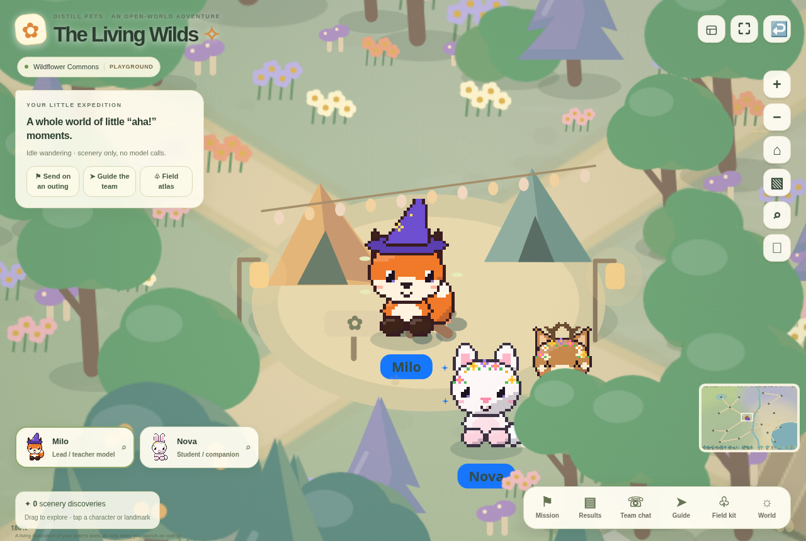
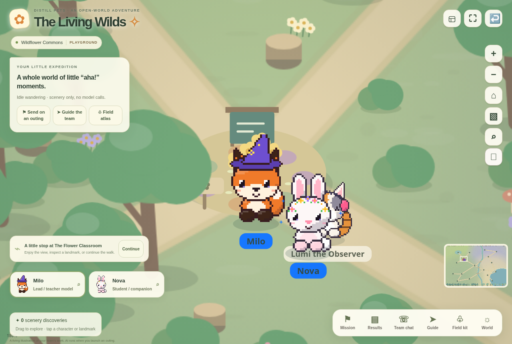

# Distill Pets AI Studio

A playful AI workspace where your pets help you write, research, build, and teach.

Meet **Milo, the teacher**, and **Nova, the student**. Each pet is a customizable
interface for a model you choose through OpenRouter. Give the teacher a task,
review a good answer, and turn its useful approach into a reusable **model chip**.
Equip that chip on a student and try a fresh task to see whether it helps.

While the models work, you can follow their companions through **the Wilds**:
a little open world with nature walks, classrooms, friendly characters, and
places to stop and learn. You can also keep the actual responses, generated
files, sources, and teacher–student messages open beside the adventure.



*Milo and Nova at Curiosity Camp. This is an actual screenshot from the free
Playground, with custom outfits and scenery; no paid model run is shown.*

## How it works

1. **Choose a job.** Try “explain rainbows to a child,” “write from my product FAQ,”
   or “build a tiny interactive garden.” Pick a model for each companion.
2. **Watch the teacher work.** Read the response directly, or follow an outing
   through the Wilds. Optional student questions and practice rounds make the
   teaching exchange visible. Send guidance to steer the next eligible step.
3. **Keep what worked.** Review the answer and click **Distill model chip**.
   Describe what you liked: perhaps the examples, structure, or tone.
4. **Review and equip the chip.** The chip stores reusable instructions and
   approved examples for a base model. It belongs to the model configuration,
   so you can move it between pets.
5. **Test a new task.** Compare the same learner with and without the chip on a
   fresh prompt. Keep, revise, or retire it based on the results.

New to distillation? Open **Distillation Trail** for a guided five-step experiment,
with visible model-call estimates and checks based on work you have completed.
**Try the playground** uses labeled prepared samples without an API key. Real
generation uses your own OpenRouter key and credits.



*A stop at the Flower Classroom. On a teaching outing, a flower, tree, or other
landmark can become an analogy for your chosen topic. The scenery illustrates
the workflow; returned model output and reviewed examples supply the learning
material. This gallery scene uses Playground mode.*

## Pets, chips, and Superpowers

| Part | What it means |
| --- | --- |
| **Pet** | Your companion and interface. Customize its species, outfit, personality, teaching voice, aura, and trail. |
| **Model** | The AI that answers the request. Choose an OpenRouter text model from the catalog or enter its model ID. Provider capabilities vary. |
| **Model chip** | A reviewed bundle of instructions and examples associated with a base model. Equip it on a pet to use that approach on later tasks. |
| **Superpower** | A custom workflow combining your instructions, reference data, success criteria, and bounded review layers. |
| **The Wilds** | An interactive visualization of tasks and teaching, with actual output available in the results and team-chat panels. |

Chips and reviewed workflow memory change the context sent to a model; **they do
not change hosted model weights**. For a separate compatible training workflow,
export approved live examples as JSONL. OpenRouter has no universal weight-training
API, and Playground samples are excluded from training exports.

You can use the studio as a focused chat workspace, a coding desk with a live
preview, a diagram workbench, or a place to build a small library of repeatable
workflows. The pets make that work visible and fun; you stay in control of what
gets approved and reused.

## Run it

Requires Node.js 22 or later.

```sh
npm ci
npm run dev
```

Open the localhost address printed by Vite. Choose **Try the playground** for
labeled samples without a key. For actual inference, open **Settings**, enter
your OpenRouter key, choose model IDs, and select live mode. Keys stay in tab
memory and are sent only to the local completion route or OpenRouter streaming
endpoint. They are excluded from saved workspaces and exports.

```sh
npm run build
npm start
```

The production server serves the built app and the same API routes on port 3000
by default. Use `PORT` to change it. Run your own HTTPS reverse proxy when serving
outside localhost. Safari's Share → Add to Home Screen installs the iPhone PWA;
supported Android browsers offer their usual install action.

## Explore

| View | What you can do |
| --- | --- |
| Workspace | Complete a task, review its output, and distill an approved example. |
| Conversations | Continue bounded streamed threads with frozen model/chip settings. |
| Distillation Trail | Follow five evidence-based steps from a teaching goal to a fresh comparison. |
| Superpowers | Create custom workflows with instructions, reference data, review layers and exports. |
| Forge studio | Edit and render Mermaid diagrams; generate safe interactive UI from a component schema. |
| Wilds / Open World | Send companions on tasks, research, code and nature-walk teaching adventures. |
| Code studio | Inspect generated files, edit, search, restore snapshots and run a sandboxed browser preview. |
| Live room / Research | Watch actual output, public tutor messages, sources and activity as work arrives. |
| Model chips / Chip lab / Compare | Review portable instructions, curate approved examples and judge blind held-out comparisons. |
| Pets / Customize / Settings | Personalize species, outfits, teaching voices, colors, themes, controls and model choices. |

The open world is a seeded 6144×4096 Canvas scene with four biomes, landmarks,
workflow NPCs and scenic enemies. Walks illustrate activity. Completed requests,
returned files and citations create resources; animation timers do not complete
AI tasks. Guidance applies at the next eligible model step. Private provider
reasoning is excluded from visible and saved transcripts.

## Create a useful Superpower

Start with one narrow job: for example, turn support notes into a response using
your own approved product FAQ. Give it a name, instructions and observable success
criteria. Add reference text or import a small text/JSON/CSV file. Run a fresh task
with the chosen model and select a bounded number of critique/revision rounds.
Review each returned layer and its reference context before reusing the result.

Reference retrieval runs locally using a deterministic text-matching method.
Generation and review use the selected model. Reviewed memory is context supplied
to later calls. Markdown, JavaScript and Python exports make the workflow
inspectable and portable. They do not execute arbitrary user-supplied code in Distill Pets AI Studio.

**Model chips and workflow memory do not update hosted model weights.** A chip
stores reusable instructions and approved examples alongside a base-model ID.
Equipping it changes the context of later calls. OpenRouter does not expose a
universal model-training API. Approved live JSONL can be exported for a separate
compatible trainer; playground samples are excluded from training exports.

## Diagrams and generative UI

Mermaid source is parsed and rendered locally with the actual Mermaid library.
Invalid source shows a useful error. Source and rendered exports remain separate.
No remote diagram-rendering service receives your source.

The generative UI workbench is an original, constrained native renderer inspired
by component-catalog approaches. It is not an embedded OpenUI or JSON Render SDK.
Only allowlisted components and explicit actions are accepted; generated HTML and
scripts cannot execute in the parent app. See the dated [GitHub integration
review](docs/research/github-review-2026-10-19.md) for projects considered and the
precise integration decisions.

## Data, costs and recovery

Workspaces are saved in this browser. Export a backup in Settings before changing
devices or clearing browser data. Limits keep threads, examples, experiments and
review rounds bounded. Interrupted runs keep useful partial work and do not
automatically restart after reload. Stop prevents later steps; an already
submitted provider request may still be billed. Live costs depend on model,
tokens, retries, search and selected review rounds.

The PWA caches its public app shell, not API responses or keys. Saved work is
readable offline. Previously unused optional renderer assets and AI generation
need a connection. Mobile layouts include safe areas, 16px inputs, touch targets,
reduced motion and landscape handling.

## Verify

```sh
npm test
```

The portable runtime tests exercise real HTTP boundaries using prepared responses.
Additional regression scripts under `tests/` cover model-chip review, conversations,
world guidance, processing layers, diagram/schema validation, avatars and phone
layouts. Browser tests use Playwright and Chromium; see `docs/testing.md`.
Provider-intercepted tests verify request construction and failure handling, not
paid inference. Real OpenRouter verification requires your own key and credits.

## Source layout

`src/` contains the app and native Canvas world; `backend/index.ts` contains the
fixed OpenRouter routes. `portable/` provides the Node HTTP runtime and Vite build.
`public/` contains PWA assets. `tests/` contains regression scripts.

Download the complete [source release](https://github.com/CartyChris/distill-pets-ai-studio/releases/latest),
or choose Code → Download ZIP for the current branch. The archive includes the
app, portable server, dependency lockfile, PWA assets, tests, documentation, and
the screenshots above. No saved workspace data or credentials are included. Third-party code keeps its respective
license; see [THIRD_PARTY_NOTICES.md](THIRD_PARTY_NOTICES.md). The pet sprite engine
comes from the supplied Pixel Pets artwork and is identified separately there.
